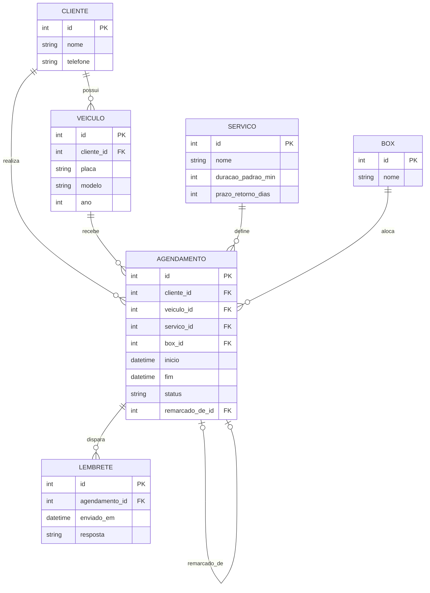

# 05 · Modelo de dados

## Decisões de modelagem

- `fim` é gravado (e não só calculado) para permitir a verificação de sobreposição direto no banco.
- `status` assume os valores de RF-07. Uma tabela de apoio é desnecessária enquanto a lista for curta.
- `remarcado_de_id` guarda o vínculo entre agendamentos (RN-08), preservando a auditoria.
- `duracao_padrao_min` fica em `SERVICO`, e não no agendamento, para que a mudança de tempo-padrão não altere o passado: o `fim` já foi gravado.
- Para impedir sobreposição mesmo sob concorrência (caso-limite de 2 usuários simultâneos), a regra RN-01 deve ser garantida na gravação, por restrição no banco ou transação com bloqueio, e não apenas na tela.
